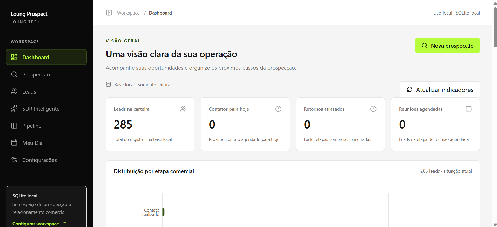
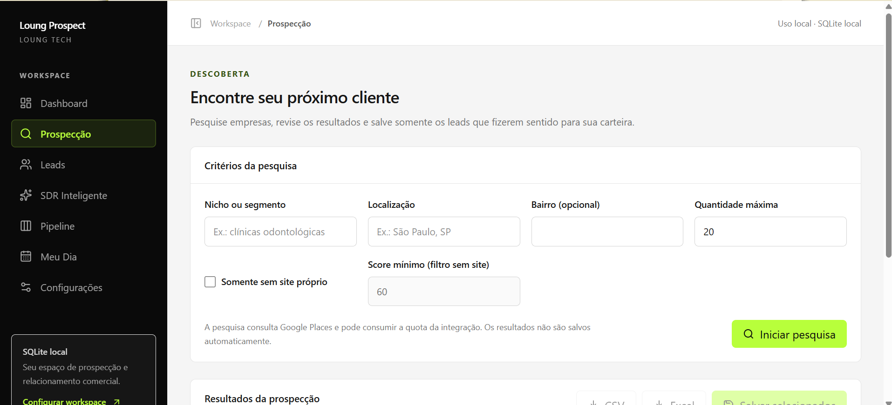
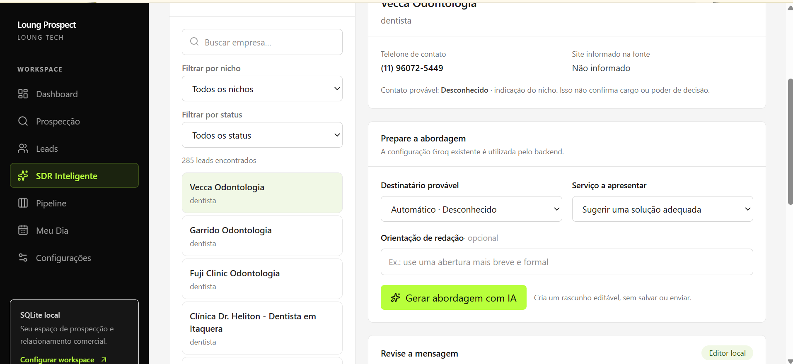
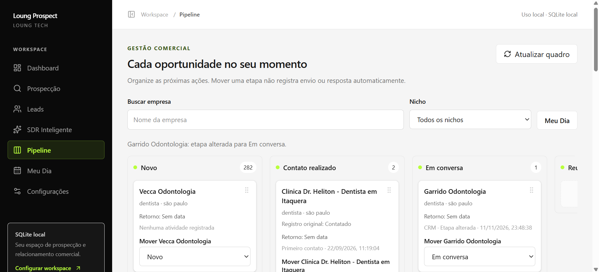

# 🚀 Loung Prospect

### Plataforma inteligente de prospecção comercial, gestão de leads e automação com IA


O **Loung Prospect** é uma plataforma desenvolvida para transformar a maneira como empresas identificam potenciais clientes, organizam oportunidades comerciais e preparam abordagens personalizadas utilizando inteligência artificial.

Desenvolvido no contexto da **Loung Tech**, o sistema integra pesquisa de estabelecimentos via Google Places, gerenciamento de leads, pipeline comercial e geração inteligente de mensagens por meio de modelos de linguagem.

O objetivo é centralizar atividades de prospecção em uma aplicação web, reduzindo processos manuais e proporcionando maior organização à operação comercial.

> **Status:** aplicação web local em desenvolvimento e evolução contínua. A versão atual utiliza SQLite e não exige autenticação. A arquitetura SaaS anterior permanece parcialmente preservada no repositório para possível evolução futura.

---

## 🎯 O problema que o projeto resolve

A prospecção comercial tradicional frequentemente envolve tarefas repetitivas:

- Pesquisar empresas individualmente.
- Coletar informações comerciais.
- Organizar contatos em planilhas.
- Identificar oportunidades relevantes.
- Elaborar mensagens personalizadas.
- Acompanhar conversas e negociações.
- Controlar atividades de follow-up.

Esses processos podem consumir tempo e dificultar o acompanhamento de oportunidades.

O Loung Prospect foi criado para centralizar essas operações e integrar recursos de inteligência artificial ao fluxo comercial.

---

## ✨ Principais funcionalidades

### 🔎 1. Prospecção de estabelecimentos

Integração com a **Google Places API** para pesquisar empresas e identificar potenciais oportunidades comerciais.

Funcionalidades:

- Pesquisa de estabelecimentos por critérios comerciais.
- Consulta de informações disponíveis na API.
- Seleção de resultados relevantes.
- Importação de empresas para a carteira.
- Deduplicação de leads.
- Exportação de informações em CSV e Excel.

A ferramenta busca facilitar a descoberta de potenciais clientes e a organização dos resultados.

### 👥 2. Gestão de leads

Ambiente centralizado para gerenciamento de potenciais clientes.

- Cadastro e edição de leads.
- Organização de informações comerciais.
- Consulta de registros.
- Filtros e pesquisas.
- Histórico de atividades.
- Acompanhamento de oportunidades.

A persistência local utiliza SQLite.

### 🤖 3. SDR Inteligente com IA generativa

Um dos principais diferenciais da plataforma é a integração com modelos de linguagem por meio da **Groq API**.

O SDR Inteligente permite:

- Selecionar o lead que receberá a abordagem.
- Definir o serviço que será oferecido.
- Gerar mensagens comerciais personalizadas.
- Ajustar orientações para a geração.
- Revisar e editar o conteúdo produzido.
- Regenerar mensagens.
- Manter histórico das abordagens.

A inteligência artificial auxilia na elaboração das mensagens, enquanto a decisão sobre o conteúdo final permanece com o operador.

### 💬 4. Integração com WhatsApp

A plataforma permite abrir uma conversa no WhatsApp com uma mensagem comercial previamente preparada.

Fluxo:

1. O operador seleciona um lead.
2. Define o serviço ou a abordagem.
3. A inteligência artificial gera uma sugestão.
4. O operador revisa o conteúdo.
5. O sistema abre a conversa no WhatsApp com a mensagem preenchida.
6. O envio é realizado manualmente.

**Importante:** o Loung Prospect não realiza disparos automáticos de mensagens na versão local documentada.

### 📊 5. Pipeline comercial

Ferramentas para organizar o acompanhamento das oportunidades.

- Gerenciamento de etapas comerciais.
- Atualização do status dos leads.
- Registro de atividades.
- Histórico de interações.
- Agendamento de follow-ups.
- Visualização da evolução das oportunidades.

### 📈 6. Dashboard

Interface para centralizar informações da operação e facilitar o acompanhamento dos dados comerciais.

O dashboard faz parte da aplicação web, permitindo navegar entre os recursos de prospecção, leads, SDR e pipeline.

---

## 📸 Demonstração da plataforma

As imagens abaixo deverão ser adicionadas a partir de capturas reais do sistema.

### Dashboard



### Prospecção



### SDR Inteligente



### Pipeline comercial



> As imagens são referências de caminho. Para visualizá-las no GitHub, adicione os arquivos correspondentes em `docs/screenshots/`.

---

## 🛠️ Tecnologias utilizadas

### Frontend

| Tecnologia | Utilização |
|---|---|
| Next.js 16 | Aplicação web e camada BFF |
| React 19 | Construção de interfaces |
| TypeScript | Tipagem e organização do código |
| Tailwind CSS 4 | Estilização |
| Recharts | Visualização de dados |
| React Hook Form | Gerenciamento de formulários |
| Zod | Validação de dados |

### Backend

| Tecnologia | Utilização |
|---|---|
| Python | Linguagem principal do backend |
| FastAPI | Desenvolvimento da API REST |
| SQLite | Persistência local |
| Google Places API | Pesquisa de estabelecimentos |
| Groq API | Integração com modelos de linguagem |

### Ferramentas

- Git e GitHub
- VS Code
- Node.js e npm
- Python venv
- Pytest
- ESLint

---

## 🏗️ Arquitetura

O projeto utiliza uma arquitetura que separa interface, comunicação HTTP, regras de negócio e persistência.

```text
                       USUÁRIO
                          |
                          v
                 +----------------+
                 |  NEXT.JS / WEB |
                 |  React + TS    |
                 +--------+-------+
                          |
                          v
                 +----------------+
                 | CAMADA BFF/API |
                 +--------+-------+
                          |
                          v
                 +----------------+
                 |    FASTAPI     |
                 |    Python      |
                 +--------+-------+
                          |
           +--------------+--------------+
           |              |              |
           v              v              v
      +---------+   +-----------+   +----------+
      | SQLITE  |   |  GOOGLE   |   |   GROQ   |
      |         |   |  PLACES   |   |   API    |
      +---------+   +-----------+   +----------+
           |              |              |
           v              v              v
      Leads / CRM     Pesquisa de      Geração de
      / Pipeline      empresas         mensagens
```

A divisão das responsabilidades permite desenvolver e testar os componentes de maneira independente.

### Estrutura principal

```text
loung-prospect/
├── backend/              # API FastAPI
├── core/                 # Regras e serviços compartilhados
├── web/                  # Aplicação Next.js
├── config/               # Configurações
├── docs/                 # Documentação técnica
├── scripts/              # Utilitários
├── tests/                # Testes
├── supabase/             # Recursos preservados da arquitetura SaaS
├── templates/            # Templates do projeto
├── .env.example
├── requirements.txt
└── README.md
```

A implementação histórica de interface desktop foi removida. A interface principal atual é web.

---

## 🚀 Como executar localmente

### Pré-requisitos

- Git.
- Python 3.11 ou superior.
- Node.js `^22.19.0` ou `>=24.6.0`.
- npm.
- Chaves de API para Google Places e Groq, caso deseje utilizar essas integrações.

O CRM local pode funcionar sem essas duas chaves, mas a pesquisa de empresas e a geração de mensagens precisam delas.

### 1. Clone o repositório

```bash
git clone https://github.com/nandoalvesferreira20-png/loung-prospect.git

cd loung-prospect
```

### 2. Configure o backend (Windows / PowerShell)

Na raiz do projeto:

```powershell
py -3 -m venv backend/.venv

backend/.venv/Scripts/python.exe -m pip install -r backend/requirements.txt

Copy-Item .env.example .env
```

Se o arquivo `.env` já existir, preserve suas configurações.

### 3. Configure as variáveis de ambiente

No arquivo `.env`:

```dotenv
LOUNG_AUTH_MODE=local
LOUNG_STORAGE_BACKEND=sqlite
LOUNG_DATABASE_PATH=data/loung_prospect.db
LOUNG_ENABLE_WRITES=1

GOOGLE_PLACES_API_KEY=
GROQ_API_KEY=
GROQ_MODEL=openai/gpt-oss-20b
GROQ_TIMEOUT=30
```

Preencha suas credenciais localmente.

**Nunca publique chaves privadas no GitHub.**

### 4. Configure o frontend

Na raiz:

```powershell
Copy-Item web/.env.example web/.env.local

cd web

npm.cmd ci
```

Configure `web/.env.local` com:

```dotenv
LOUNG_AUTH_MODE=local
LOUNG_API_URL=http://127.0.0.1:8000
```

### 5. Execute o backend

Em um terminal, a partir da raiz:

```powershell
backend/.venv/Scripts/python.exe -m backend.scripts.run_api --env-file .env
```

API:

http://127.0.0.1:8000

Verificação de funcionamento:

http://127.0.0.1:8000/health

### 6. Execute o frontend

Em outro terminal:

```powershell
cd web

npm.cmd run dev
```

Abra:

http://127.0.0.1:3000

A aplicação é destinada à execução local, utilizando o endereço `127.0.0.1`.

---

## 🧪 Qualidade e testes

O projeto possui estrutura de testes para o backend, serviços de negócio e aplicação web.

### Testes do frontend

Dentro de `web/`:

```bash
npm test
npm run typecheck
npm run lint
npm run build
```

### Testes Python

Na raiz do repositório, em um ambiente Python com as dependências de desenvolvimento instaladas:

```bash
python -m pip install -r requirements-dev.txt -r backend/requirements-dev.txt

python -m backend.scripts.run_offline_tests tests backend/tests
```

Os testes utilizam recursos locais e ambientes controlados, sem depender de uma base comercial real.

---

## 🔐 Privacidade e segurança

O Loung Prospect utiliza diferentes medidas para organizar o tratamento das informações:

- Separação entre configurações públicas e credenciais privadas.
- Armazenamento local dos leads na versão atual.
- Exclusão de bancos e arquivos de ambiente do versionamento.
- Backups para operações de migração local.
- Revisão humana de mensagens geradas por IA.
- Envio manual das abordagens por WhatsApp.
- Validações de dados nas operações comerciais.

O sistema deve ser utilizado respeitando a legislação aplicável de proteção de dados, as políticas das APIs integradas e as regras das plataformas de comunicação.

---

## 🧠 Desafios técnicos e aprendizados

### Integração entre diferentes tecnologias

Combinar uma interface Next.js com um backend Python exigiu definir contratos de comunicação, organização de rotas e responsabilidades entre as camadas.

### Consistência e deduplicação de leads

O gerenciamento de dados comerciais exige evitar registros duplicados e preservar informações existentes durante importações.

### Aplicação prática de IA generativa

A integração com Groq foi desenvolvida para apoiar um processo comercial real, permitindo gerar, revisar e utilizar abordagens personalizadas.

### Persistência e integridade dos dados

A utilização de SQLite exigiu cuidados com migrações, operações de escrita, backups e consistência das informações.

### Evolução arquitetural

O projeto passou por mudanças de arquitetura, incluindo a transição de uma interface desktop para uma aplicação web e a experimentação com recursos de uma estrutura SaaS.

Essas mudanças fazem parte do processo de evolução e aprendizado em engenharia de software.

---

## 🗺️ Roadmap

Possibilidades de evolução:

- [ ] Evoluir a arquitetura para utilização multiusuário.
- [ ] Retomar e validar a estrutura SaaS com PostgreSQL e autenticação.
- [ ] Ampliar os indicadores do dashboard.
- [ ] Expandir automações comerciais com controles de segurança.
- [ ] Melhorar observabilidade e monitoramento.
- [ ] Ampliar testes automatizados e cobertura de integração.
- [ ] Avaliar integração oficial com WhatsApp Business para novos fluxos comerciais.

Os itens representam possibilidades futuras e não funcionalidades disponíveis na versão local atual.

---

## 👨‍💻 Sobre o desenvolvedor

**Fernando Ferreira Alves**

Estudante de Engenharia de Software, com experiência prática em desenvolvimento de aplicações, análise de dados, automações e integração de inteligência artificial.

O Loung Prospect representa minha experiência construindo uma solução de ponta a ponta, desde a organização das regras de negócio até a integração entre frontend, backend, banco de dados e APIs externas.

O projeto faz parte das soluções desenvolvidas no contexto da **Loung Tech**.

### Contato

[](https://github.com/nandoalvesferreira20-png)
[](https://www.instagram.com/fernandev.tech/)
[](https://loung-tech.vercel.app/)

---

<p align="center">
  <strong>Loung Prospect — Transformando prospecção comercial em um processo mais inteligente, organizado e eficiente.</strong>
</p>

<p align="center">
  Desenvolvido com Python, Next.js e Inteligência Artificial.
</p>
