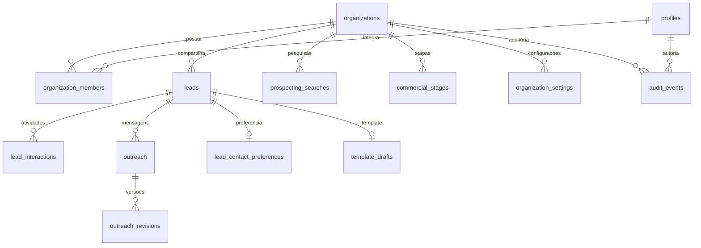

# Fase 3.1 — auditoria anterior à implementação

A inspeção do repositório, documentação Fases 1/2.1/2.2/2.3/2.4, routers, BFF, serviços e repositórios foi concluída em 19/10/2026. O inventário verificável está em phase-3-1-audit.json. A base real contém **160 leads e 17 interações**, apenas duas tabelas; o schema suportado pelo desktop também prevê outreach, outreach_revisions, lead_contact_preferences e template_drafts. Não há FKs físicas na origem. Não presumir que os históricos SDR existem nesta base.

Leads concentram status, observações, qualificação e um próximo follow-up; interações referem lead_id. Outreach refere lead_id, revisões referem outreach_id/lead_id, preferências e templates têm lead_id como PK. Configurações desktop são locais ao SO; pesquisas e drafts web são temporários em memória. Escritas: SelectionStore.save, SdrStore.save e CrmService.mutate; leitura: ReadRepository e os dois serviços. Core/database também escreve para desktop e não será alterado.

Status canônicos e aliases estão em core/commercial/values.py; Meu Dia em core/commercial/day.py. Rascunho, cópia e abertura WhatsApp não confirmam contato. Revisão SHA-256 do lead protege contra sobrescrita comercial. Redesign preserva filtros, Kanban, perfil, atividade, retorno e SDR via BFF; verificações anteriores constam dos relatórios das fases. Backup SQLite já usa API backup/quick_check antes de escrita. Não chamar construtores desktop na migração.

Estratégia: preservar colunas e IDs externos; IDs internos bigint para manter contratos HTTP, IDs UUID para usuários/organizações. FKs compostas com organização, RLS, autoria por trigger a partir de JWT verificado, auditoria append-only. Datas legadas permanecem texto para não inventar fusos; timestamps da infraestrutura são timestamptz. Script independente lê origem mode=ro, cria snapshot íntegro, valida órfãos/tipos/datas/deduplicação e mantém mapa de IDs por origem/organização. Reexecução não sobrescreve alterações comerciais. Nenhuma execução real automática.

## Arquitetura implementada

Browser → BFF Next.js → FastAPI → PostgreSQL. Supabase Auth fornece sessão em cookies via SDK SSR, refresh e recuperação. O proxy Next valida usuário; cada BFF obtém o token da sessão validada, sem aceitar identidade arbitrária do navegador. O FastAPI verifica assinatura ES256/RS256 em JWKS, issuer, audience, expiração, role authenticated e UUID sub. HS256 legado é recusado: usar signing keys assimétricas. Referências oficiais: https://supabase.com/docs/guides/auth/signing-keys e https://supabase.com/docs/guides/auth/server-side/creating-a-client.

Não há signup na interface. Uma conta Auth sem membership recebe 403. A organização padrão é selecionada entre memberships verificadas no servidor, ordenadas por slug. X-Organization-ID é somente um seletor validado, jamais autorização; o BFF atual não o encaminha. O frontend identifica usuário/organização e permite logout. A sessão é revalidada a cada minuto e em cada endpoint; dados comerciais possuem atualização sob demanda nos controles existentes. Convites e mudança de papel são operações administrativas via Dashboard/SQL, sem endpoint público de gerenciamento nesta fase.

O runtime usa SET LOCAL ROLE loung_api, claims derivadas do JWT e organização por transação. Esse papel é NOLOGIN/NOBYPASSRLS e não pode alterar memberships, profiles, organizations nem auditoria. Nunca usar DSN administrativa no processo web. A conexão de login dedicada precisa poder SET ROLE loung_api. Nenhuma service role key é usada na aplicação. RLS exige membership e organização ativa, inclusive nas tabelas de negócio com FORCE RLS. O navegador tem apenas SELECT sob RLS; sem contexto de organização não há leitura comercial. Escritas diretas via PostgREST não são concedidas: confirmações e validações passam pelo FastAPI.

O adaptador PostgreSQL executa as consultas existentes com tradução pequena do dialeto (parâmetros, metadados PRAGMA, funções puras, RETURNING). Não executa SQLite nem mantém uma cópia SQLite no runtime PostgreSQL. A camada preserva os serviços e contratos, enquanto o desktop continua usando os seus repositórios originais. Leituras usam snapshot REPEATABLE READ/READ ONLY; escritas usam advisory lock transacional por organização mais revisão SHA-256. Isso serializa as escritas desta primeira carteira pequena. Não há fallback quando PostgreSQL falha; retorna 503 sanitizado. Prepared statements automáticos ficam desabilitados para compatibilidade com poolers.



Cada tabela comercial possui organization_id; relações de lead e outreach usam FKs compostas, impedindo referências cruzadas. Leads mantêm bigint para preservar contratos; Auth/organizações usam UUID. Unicidade de provider/place ID é por organização. Deduplicação preserva critérios externos: provider/place ID, URL Maps, empresa/endereço, empresa/telefone, nunca apenas empresa. Status personalizados permanecem em leads.status e são oferecidos pelo pipeline; commercial_stages está prevista para gestão futura. Follow-ups continuam como ponteiro único em leads, sem agenda paralela. Notas novas são eventos. Datas legadas são preservadas em texto e sinalizadas quando inválidas; timestamps de infraestrutura têm fuso.

Triggers stamp_actor ignoram created_by/updated_by fornecidos na escrita e usam auth.uid(). Audit e alteração participam da mesma transação. Interações, revisões e auditoria não têm UPDATE/DELETE para o runtime. O histórico mostra nomes dos autores obtidos no servidor; registros importados permanecem sem atribuição inventada. Auditoria de leads guarda status, notas e follow-up anterior/novo, sem duplicar telefone/e-mail. Payload de pesquisa e valores de configuração não são copiados à auditoria. Atividades automáticas sem ator ficam identificadas como migration; geração/revisão continua ação atribuída ao usuário. Abrir WhatsApp não cria contato.

Pesquisas têm snapshots inicial/final duráveis em prospecting_searches. Resultados podem ser reabertos após restart; execução interrompida é identificada como falha, sem retomada automática de chamadas pagas. Filas e drafts de geração ainda são por processo/organização, com retenção e limites; rodar **um worker Uvicorn**. Configurações desktop/segredos continuam separadas; preferências pessoais da tela Configurações continuam explicitamente locais ao navegador. organization_settings é a estrutura preparada para configurações comerciais persistentes futuras, sem endpoints para armazenar segredos.

## Ambiente local e instalação

Não editar .env existente. Fornecer variáveis ao processo ou usar arquivos separados manualmente. Os nomes reais estão em backend/.env.example e web/.env.example.

| Variável | Uso |
|---|---|
| LOUNG_STORAGE_BACKEND | postgres por padrão no processo; sqlite somente opt-in local |
| LOUNG_POSTGRES_DSN | login PostgreSQL restrito, apenas backend; usar TLS no Supabase |
| SUPABASE_URL | URL Auth confiável do projeto, apenas servidor |
| SUPABASE_AUTH_AUDIENCE | authenticated por padrão |
| LOUNG_ENABLE_WRITES | 1 habilita importação/CRM/SDR; padrão 0 |
| NEXT_PUBLIC_SUPABASE_URL | URL pública do mesmo projeto Auth |
| NEXT_PUBLIC_SUPABASE_PUBLISHABLE_KEY | chave publishable/anon pública, sem privilégios administrativos |
| LOUNG_API_URL | destino fixo BFF, nesta fase loopback http://127.0.0.1:8000 |
| LOUNG_AUTH_MODE | omitido para Supabase; local só para fixtures/SQLite isolado em loopback |
| LOUNG_DATABASE_PATH | apenas modo SQLite, apontar cópia de teste |
| LOUNG_MIGRATION_DSN | conexão administrativa somente no comando manual de migração |
| GOOGLE_PLACES_API_KEY | backend, configuração existente preservada |
| GROQ_API_KEY / GROQ_MODEL | backend, configuração existente preservada |

```powershell
backend/.venv/Scripts/python.exe -m pip install -r backend/requirements-dev.txt
# Depois de configurar Auth, DSN restrita e aplicar SQL no ambiente escolhido:
backend/.venv/Scripts/python.exe -m uvicorn backend.main:app --host 127.0.0.1 --port 8000
# Em web, outro terminal:
npm.cmd ci
npm.cmd run dev
```

Não executar o modo SQLite anônimo em ambiente acessível por rede. Host/origin e destinos BFF permanecem locais nesta entrega; configuração de proxy remoto/TLS fica para a fase de deploy. Falta de configuração de PostgreSQL/Auth produz 503 controlado, não acesso anônimo.

## Inicialização e convites — passos manuais

1. Criar um projeto Supabase de desenvolvimento, manter cadastro público desabilitado, configurar política de senha, SMTP e URLs permitidas. Ativar chaves de assinatura assimétricas. Não executar testes no projeto real.
2. Revisar e aplicar explicitamente supabase/migrations/202610190001_phase31.sql pelo SQL Editor/CLI no projeto escolhido. A migration cria somente a organização Loung Tech, sem usuários ou dados comerciais.
3. Criar login dedicado sem privilégios administrativos. Em psql administrativo, executar `CREATE ROLE loung_web LOGIN NOINHERIT NOBYPASSRLS; GRANT loung_api TO loung_web;` e definir senha fora do código com `\password loung_web`. A DSN do backend deve usar esse login. Não definir BYPASSRLS nem ownership de tabelas para ele.
4. Administrador autorizado convida Fernando, Laís, Miqueias e Marwin pelo Dashboard Auth, usando seus e-mails reais confirmados fora do código. Não há e-mails ou senhas embutidos. Obter os UUIDs criados em auth.users.
5. Provisionar profile e membership numa transação administrativa parametrizada. Usar variáveis psql fornecidas pelo operador, sem substituir valores fixos no repositório:

```sql
BEGIN;
INSERT INTO public.profiles(id,display_name)
SELECT id, :'display_name' FROM auth.users WHERE id=:'user_id'::uuid
ON CONFLICT(id) DO UPDATE SET display_name=excluded.display_name;
INSERT INTO public.organization_members(organization_id,user_id,role)
SELECT o.id,p.id,:'member_role'
FROM public.organizations o CROSS JOIN public.profiles p
WHERE o.slug='loung-tech' AND p.id=:'user_id'::uuid
ON CONFLICT(organization_id,user_id) DO NOTHING;
COMMIT;
```

Escolher owner/admin/member explicitamente; mudança posterior de papel exige revisão do operador autorizado. A aplicação não concede a um membro direito de executar SQL administrativo. Revogar membership impede novas operações imediatamente; tokens Auth continuam sujeitos ao prazo de expiração e à política de revogação do Supabase.

6. Configurar templates de e-mail com `{{ .SiteURL }}/auth/confirm?token_hash={{ .TokenHash }}&type=invite` para convites e type=recovery para recuperação. Confirm permite apenas esses dois tipos e redireciona para /atualizar-senha, sem redirect externo arbitrário. Site URL e allowlist devem corresponder ao endereço local escolhido. Testar recebimento real/expiração em desenvolvimento antes do deploy.
7. Configurar variáveis de ambos os processos. Conferir login, acesso compartilhado, recuperação e logout com os usuários convidados. Nada disso foi executado contra contas reais nesta entrega.

## Migração e recuperação

O script separado backend/scripts/migrate_sqlite.py abre origem mode=ro, faz snapshot com backup API e integrity_check e migra o snapshot. Mantém mapa por organization/source-id/tabela/id; falha reverte toda transação, permitindo repetir. IDs de filhos são remapeados; a reexecução ignora itens mapeados e não sobrescreve edições feitas no CRM. Origem sem uma das tabelas suportadas tem zero registros nessa tabela. Colunas/tabelas desconhecidas exigem revisão; não são descartadas silenciosamente. Órfãos, tipos inteiros e campos obrigatórios inválidos bloqueiam escrita; datas inválidas/sem fuso são contadas e preservadas para revisão, sem inventar timezone. Relatórios não contêm contatos, mensagens ou credenciais.

Dry-run padrão, sem rede e sem alvo real:

```powershell
backend/.venv/Scripts/python.exe -m backend.scripts.migrate_sqlite --sqlite data/loung_prospect.db --organization UUID_DA_ORGANIZACAO --source-id loung-desktop --dry-run --report backend/migration-report.json
```

Escrita real **somente após aprovação e comando explícito do operador**, com LOUNG_MIGRATION_DSN no ambiente desse processo:

```powershell
backend/.venv/Scripts/python.exe -m backend.scripts.migrate_sqlite --sqlite data/loung_prospect.db --organization UUID_DA_ORGANIZACAO --source-id loung-desktop --apply --confirm UUID_DA_ORGANIZACAO --report backend/migration-report.json
```

Usar o mesmo source-id em repetições da mesma origem. Novo source-id não é mecanismo de atualização. Identidades já existentes no alvo são preservadas e contabilizadas como ignoradas; filhos recebem o ID correspondente. Revisar divergências comerciais de duplicados antes de migrar, não mesclar observações/status automaticamente. O mapa garante idempotência do lote importado, não sincronização bidirecional desktop/web.

Antes da migração real, fazer backup/PITR do alvo, inventário e conferência dos totais. O dry-run desta execução: 160 leads + 17 interações, zero rejeitados/órfãos/duplicidades/avisos de data; backup íntegro em data/backups e relatório backend/phase31-dry-run.json. O SQLite original não foi alterado.

Recuperação: erro antes do commit implica rollback completo. Corrigir a causa e repetir mesmo source-id. Após commit com dados divergentes, parar escritas, preservar evidências e restaurar o snapshot/PITR do PostgreSQL em uma base separada para comparação; não executar DELETE/TRUNCATE automático. Para voltar temporariamente ao desktop, usar o SQLite original intacto. Escritas posteriores feitas na web não retornam automaticamente ao desktop; exportar e reconciliar antes de trocar a fonte operacional. Não há down migration destrutiva.

## Testes reproduzíveis

O runner offline bloqueia DNS/conexões externas. Fixtures só usam identidades geradas e dados sintéticos. PostgreSQL de testes usa PGlite/WASM em memória, sem conexão a projetos Supabase e sem persistir estado em disco. Referência: https://pglite.dev/docs/pglite-socket. O servidor contém marcador conferido pelos testes e porta fixa 55431; os testes PostgreSQL não leem DSNs de ambiente e pulam explicitamente se o servidor não foi iniciado. PGlite não substitui a homologação de PostgreSQL/Supabase real para locks distribuídos e infraestrutura Auth.

```powershell
# Terminal 1, raiz:
node web/scripts/phase31-postgres.mjs
# Terminal 2, raiz:
backend/.venv/Scripts/python.exe -m backend.scripts.run_offline_tests backend/tests -q --basetemp=backend/.phase31-tests -o cache_dir=backend/.pytest_cache
# Em web:
npm.cmd run lint
npm.cmd run typecheck
npm.cmd run build
```

Navegador autenticado sem Supabase real:

```powershell
# Com PostgreSQL sintético em execução, terminal separado na raiz:
backend/.venv/Scripts/python.exe -m uvicorn backend.tests.phase31_fixture_server:create_app --factory --host 127.0.0.1 --port 8100
# Em web, terminal separado; valores exclusivamente sintéticos:
$env:NEXT_PUBLIC_SUPABASE_URL='http://127.0.0.1:8100'
$env:NEXT_PUBLIC_SUPABASE_PUBLISHABLE_KEY='synthetic-test-publishable-key'
$env:LOUNG_API_URL='http://127.0.0.1:8100'
npm.cmd run build
npm.cmd run start -- --port 3100
# Raiz, ambiente que tenha Playwright/Edge:
.venv/Scripts/python.exe web/scripts/check_phase31.py
```

As rotas __test e o Auth sintético só existem na factory de teste; nunca executar essa factory fora do ambiente local. Interromper servidores sintéticos e reconstruir frontend com configuração real antes de homologar. Não deixar os valores sintéticos em .env.

## Limitações e verificação antes do deploy

- Validar SMTP, templates de convite/recuperação, rotação de chaves, cookies HTTPS e expiração com Supabase de homologação. Testes locais simulam o serviço Auth, não sua infraestrutura.
- Rodar uma revisão de segurança e testes de concorrência em PostgreSQL nativo com o login restrito e duas organizações. PGlite multiplica conexões sobre um único backend e não demonstra comportamento distribuído.
- Um worker; sem fila externa ou retomada de execução paga. Snapshots de pesquisa são duráveis, drafts não salvos continuam temporários.
- Configurar backups PostgreSQL/PITR e ensaiar restauração; definir retenção de leads, pesquisas e auditoria. O runtime não produz backups PostgreSQL por requisição.
- Gestão de membros/roles por operador autorizado, sem tela administrativa. commercial_stages/organization_settings são estruturas preparadas; preferências pessoais continuam locais.
- BFF/FastAPI seguem restritos a loopback; preparar infraestrutura, TLS, hosts permitidos e política de origem na fase de deploy.
- Não considerar build como prontidão para produção. Nenhuma publicação, convite real ou migração real foi realizada.

## Resultado desta execução — 19/10/2026

| Verificação | Resultado |
|---|---|
| Backend offline, incluindo PostgreSQL sintético | **114 aprovados** |
| Regressão desktop: test_database.py + test_commercial.py | **48 aprovados** no ambiente desktop |
| Lint / TypeScript / build Next.js | **Aprovados** |
| Navegador Edge headless, caminho Auth → BFF → FastAPI → PostgreSQL | **Aprovado** |
| Navegador: login inválido/válido, sessão após reload, logout e proteção das rotas/API | **Aprovado** |
| Navegador: solicitação de recuperação, usuário sem organização, nota com autoria | **Aprovado**, Auth sintético sem envio de e-mail |
| Layouts 1440/1024/390 px | **Aprovados**, sem overflow horizontal |
| Duas requisições simultâneas com mesma revisão | **Uma 200, outra 409**, sem perda de atualização |
| Duas organizações + dois membros na mesma carteira | **Isolamento e compartilhamento aprovados** |
| Migração repetida e preservação de revisões SDR | **Aprovado** com dados sintéticos |
| Dry-run da origem real | **160 leads + 17 interações**, backup íntegro, nenhuma escrita no alvo |
| SHA-256 do SQLite antes/depois | **Idêntico:** 7c36ef1d20e6f4859937111f43baa8964dd62b9bd7adaeaafffeb00b66adbd39 |

Captura do perfil autenticado revisada em backend/.phase31-visual/authenticated-profile.png (somente dados sintéticos). O teste de navegador levou à proteção do formulário de Auth antes da hidratação, evitando submissão perdida em navegação rápida. Autoria de notas e mensagens é renderizada no histórico. O evento de criação também resolve o autor do INSERT, sem atribuir dados legados a usuários atuais.

O teste adicional de contact_routing não foi repetido no ambiente desktop porque Groq não está instalado nele; a tentativa no ambiente backend encontrou ausência de Playwright no conftest desktop. Nenhum dos ambientes desktop foi modificado para contornar essas dependências. As 114 verificações do backend incluem regressão de roteamento SDR com providers simulados. O aviso conhecido Starlette/httpx é de depreciação e não causa falha.

A instalação npm informou cinco avisos de severidade alta na árvore de dependências. A consulta detalhada `npm audit` foi bloqueada por `self-signed certificate in certificate chain` do ambiente; a verificação completa de advisories fica pendente de CA confiável configurada. Não foi desabilitada validação TLS nem aplicado `audit fix --force`. Revisar esses avisos antes do deploy.

Nenhum servidor sintético deve permanecer em execução após a validação. Nenhum .env existente, arquivo desktop em core/ui ou SQLite original foi modificado. Não foram criadas contas reais, executadas chamadas Google/Groq reais, aplicadas migrations em Supabase real ou publicada a aplicação.
